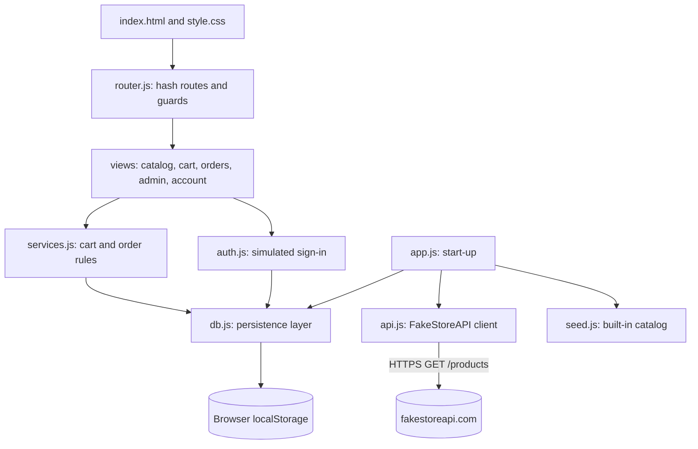
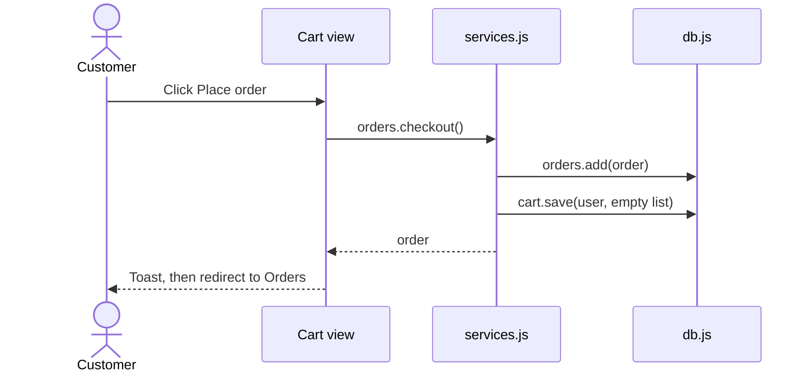
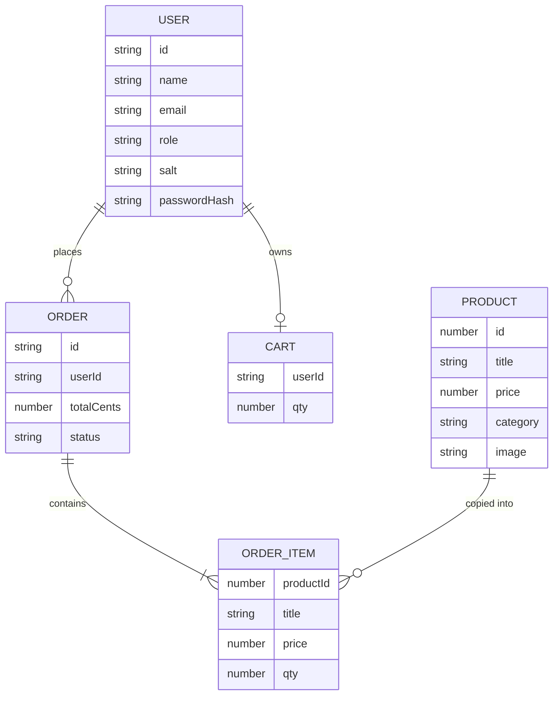

# Capstone Shop

A complete e-commerce storefront built with plain HTML, CSS and JavaScript. It has simulated sign-in with customer and admin roles, a live product catalog, a shopping cart, orders, and an admin area to add, edit and delete products. All data is saved in the browser, so state survives reloads.

**Live site:** `<paste your deployed URL here>`
**Source code:** `<paste your GitHub repository URL here>`

## Feature highlights
- **Authentication simulation:** register, sign in, sign out, 8-hour sessions, salted SHA-256 password hashes, and `customer` and `admin` roles. Cart, orders and admin pages are guarded.
- **Interactive catalog:** products load from the public [FakeStoreAPI](https://fakestoreapi.com) with `async/await`. Real-time search, category tabs, sorting, and a details dialog. If the API cannot be reached, a built-in catalog is used.
- **Dynamic CRUD:**
  - Admin: create, read, update and delete products.
  - Customer: add, change and remove cart lines, place orders, cancel orders.
  - Admin: move orders from placed to shipped to delivered.
- **Persistent state:** products, users, session, carts per user, orders and preferences live in `localStorage`.
- **Accessible:** semantic landmarks, skip link, labelled fields with inline error messages, focus management on page changes, accessible dialogs, live announcements and 44 px tap targets.
- **Responsive:** mobile-first CSS Grid and Flexbox with design tokens, light and dark themes, and tables that turn into cards on phones. No horizontal scrolling at 320 px.
- **Production touches:** Content Security Policy, all API text inserted with `textContent` (no `innerHTML`), https-only image URLs, loading skeletons, and friendly error messages.

## Demo accounts
| Role | Email | Password |
|---|---|---|
| Admin | `admin@shop.demo` | `Admin#2026` |
| Customer | Register any email on the Register page | At least 8 characters |

## Architecture

### Layers


- **Views** only build the page. Rules live in `services.js`, and only `db.js` touches `localStorage`. Only `api.js` touches the network.
- Scripts use the module pattern (each file adds one object to `window.App`), so no bundler is needed and the site works from any static host or by double-clicking `index.html`.

### Checkout flow


### Data model (stored in localStorage)


Order lines are copies of product data taken at checkout, so later price changes do not alter past orders.

## Routes
| Route | Who can open it |
|---|---|
| `#/` | Everyone |
| `#/login`, `#/register` | Signed-out visitors |
| `#/cart`, `#/orders` | Signed-in users |
| `#/admin` | Admins only (others see "Access denied") |

## Project structure
```
index.html          page shell, header, footer, live regions
style.css           design tokens, themes, layout, components
js/
  ui.js             DOM helpers, dialogs, toasts, form validation
  api.js            FakeStoreAPI client (timeout, error handling)
  seed.js           built-in fallback catalog
  db.js             localStorage persistence layer
  auth.js           simulated authentication and roles
  services.js       cart and order rules
  router.js         hash router with guards
  app.js            start-up
  views/            catalog, cart, orders, admin, account
```

## Setup
No installs are needed.
1. Download or clone the repository.
2. Open `index.html` in a browser (internet is needed on the first visit to load the live catalog).

To run it on a local server instead: `python -m http.server 8000` in the project folder, then open http://localhost:8000.

## Deployment
It is a static site with relative paths and hash routes, so it works on any static host with no build command.

**Netlify (about 2 minutes):** go to https://app.netlify.com/drop and drag the project folder onto the page. Netlify gives you a public URL.

**GitHub Pages:** push the files to a public repository, open **Settings**, then **Pages**, choose **Deploy from a branch**, select `main` and `/ (root)`, and save. The site appears at `https://<username>.github.io/<repository>/`.

**Vercel or Cloudflare Pages:** import the repository, leave the build command empty and set the output directory to the project root.

## Limitations
- Sign-in is a **simulation**. Accounts, passwords and roles are stored in the browser, so this is not real security and no payment is taken. A real version needs a server and database.
- Data is stored per browser. Clearing site data resets the shop, and the admin account is recreated automatically.
